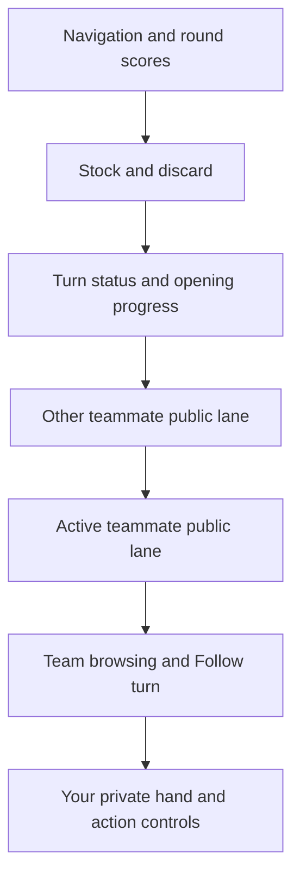

# Hand and Foot implementation plan

Build Hand & Foot as the fourth Cards game, using the shared Cards account system and its own independently running game service. Use Golf's focused mobile table approach on desktop and mobile. Individual games show one player's tableau; partnership games show a team's two player lanes, with the active teammate below the other. The viewer's private hand stays at the bottom of the screen.

The selected design is **O2 Petal and antique gold**, **Bitter and Figtree**, the **book title emblem**, and **Single Leaves** card backs. The light back uses **M3 Rose Clay**. Rules below combine the [Bicycle Hand and Foot reference](https://bicyclecards.com/how-to-play/hand-and-foot) with Emily's explicit player-count, deck-count, and shared-team decisions. Unresolved house rules are isolated before engine work.

## Confirmed requirements

- Individual scoring supports **2–6 total players**. Partnership scoring supports **4, 6, or 8 total players**, arranged as two-person teams. The lower bounds and even partnership sizes follow from needing competing scoring sides.
- **Number of decks = number of seated players + 1.** Count human and bot seats. A full deck is provisionally 52 cards plus two Jokers. Four players use five decks; six use seven; eight use nine. With two Jokers per deck, an eight-player match contains 486 physical cards.
- Shared login covers Cards, Hearts, Euchre, Golf, and Hand & Foot. Hand & Foot owns multiplayer gameplay and persistence.
- Use the cycling table on every screen size. In team mode, cycle between teams, showing both teammates' public boards. In individual mode, cycle between players.
- Team melds are shared. Two visual lanes identify who started a meld; either teammate can extend it on their turn. Only the active player acts.
- Keep the private hand at the bottom, including while browsing other boards. Opponents' and partners' private cards remain hidden.
- Offer the standard card design, including new readable Joker faces.

Use `scoringMode` for individual versus partnership play and `playMode` for practice versus online play. This keeps individual scoring distinct from a single human playing against bots.

## Selected appearance

Use the sister sites' home menu, navigation, Play, lobby, Rules, About, account, and leaderboard structure. Give Hand & Foot its own tokens and assets.

- Light website: outer `#DFD3C3`, panel `#F1E7D8`, text `#613A43`, emblem `#CFB7B5`, primary buttons `#DCAAA2`, secondary buttons `#C7AA6A`.
- Dark website: outer `#2D2027`, panel `#4B303B`, text `#F4E8DD`, emblem `#7E5B63`, primary buttons `#DCAAA2`, secondary buttons `#B99A5F`.
- M3 light card back: ground `#C1948A`, books `#51303A`, leaves `#754A50`, frame `#F1D5CD`, gold `#ECD2A0`, edge `#8E625F`.
- Dark card back: ground `#4B303B`, books, leaves, and frame `#E5B1B6`, gold `#C7AA6A`, edge `#A26F7C`.
- Buttons retain the upper-left shine and `inset -3px -3px` shadow made from a darker shade of their own fill. Pressed shadows reverse direction.

Finalize the accepted Single Leaves geometry as native SVG assets in regular and miniature sizes. Keep its mirrored layout and stronger inner frame. Self-host the selected fonts with their license files; retain the existing licensed control-icon approach. Standard suits retain their familiar red/black identities independently of the decorative palette.

### Background music

Use **all seven tracks from Golf's background-music rotation**, preserving its existing Alex Morgan/Pixabay credits:

- Jazz Cocktail Bar Music: `backgroundmusic.mp3`.
- Jazz Restaurant Music: `alex-morgan-jazz-restaurant-music-556244.mp3`.
- Jazz Dinner Restaurant Music: `alex-morgan-jazz-dinner-restaurant-music-556236.mp3`.
- Jazz Bar Restaurant Music: `alex-morgan-jazz-bar-restaurant-music-564253.mp3`.
- Cocktail Jazz: `alex-morgan-cocktail-jazz-556233.mp3`.
- Jazz Cocktail Lounge Music: `alex-morgan-jazz-cocktail-lounge-music-556246.mp3`.
- Jazz Rainy Lounge Music: `alex-morgan-jazz-rainy-lounge-music-556235.mp3`.

Adapt Golf's [`SoundContext.tsx`](../../golf/web/src/context/SoundContext.tsx) playlist behavior: play each track once per shuffled cycle, then reshuffle without immediately repeating the previous cycle's final track. Pausing and resuming preserves the current song and rotation. Keep the provider alive across Hand & Foot page changes; dealing, round transitions, and rematches do not reset the playlist.

Copy the existing audio assets into Hand & Foot's own public sounds directory and resolve them through its base-path-aware asset helper. Keep music and effects controls independent, retain opt-in playback and saved volume settings, and use Hand & Foot storage keys. Reuse the shared `cards.background-music.v1` playback lock from [`musicPlayback.ts`](../../golf/web/src/lib/musicPlayback.ts) so the sister sites do not play over each other. Preserve Golf's blocked-playback and stale-callback protections.

## Rules baseline and remaining decisions

The resolved [family preset](family-rules.md), including the October 26 red-three, natural-majority, and twos-book clarifications, supersedes the original baseline and questions below.

### Bicycle baseline

Four rounds require opening totals of 50, 90, 120, and 150. Deal 11-card hands and feet. Draw two, then discard one. Melds contain 3–7 cards; clean books score 500 and dirty books 300. Dirty books require four naturals; wild-only books and melding threes are excluded. Jokers score 50, twos/aces 20, eights–kings 10, threes–sevens 5. Played card values add; leftover hand values deduct. Drawn red threes are exposed and replaced. Discard pickup takes seven, needs two matching cards and immediate use of the top card; black threes block it. The other six cannot establish the opening minimum. Going out needs both book types and a final discard. Highest cumulative score wins. [Source: Bicycle](https://bicyclecards.com/how-to-play/hand-and-foot).

### House rules to clarify

1. **Wilds:** Must unfinished wild melds already contain four naturals?
2. **Threes:** Bonuses, penalties, and treatment when dealt or left in a foot?
3. **Foot:** Immediate after melding out; next turn after discarding out?
4. **Going out:** Partner permission, both players in foot, and bonus?
5. **Piles:** Short discard pickup and empty stock?
6. **Books:** Extra cards or a second book of the same rank?
7. **Endings:** Ties, blocked rounds, and leftover-foot penalties?

Implement these choices in a versioned `Ruleset`, with a resolved preset recorded in every match. The same preset drives validation, bots, score explanations, and Rules-page examples. Resolve the affected choices before shipping their engine behavior. The player's deck formula above is a fixed project requirement.

For individual play, propose treating each player as their own scoring side under the same approved preset. For partnerships, opening progress, book requirements, and scores belong to the team. Propose a randomly chosen first dealer and clockwise dealer rotation between rounds.

## Table layout and interaction

### Shared screen structure

Keep scores, stock, discard, and turn status outside the cycling area so browsing a board never moves the draw controls. The large middle region belongs to the focused scoring side. Place browsing controls immediately above the hand dock.

Individual mode uses one large public lane in place of the two team lanes. Desktop provides more room for columns and readable cards while preserving this same structure.

### Team pages

- Each meld has a stable ID, team owner, rank, card IDs, and creator lane. Playing into a teammate's meld updates that same object.
- New melds begin in the active player's lower lane. Existing melds remain in their creator's lane for the round.
- When a partner becomes active, bring their lane to the bottom. The layout changes position without transferring meld ownership.
- Summarize team score, opening status, and clean/dirty book counts once per team. Show both players' public hand counts and Hand/Foot status beside their names.
- On a nonactive team page, use a stable lane order, favoring the local player at the bottom of their own team page. Show no active-playing highlight there.
- Either lane can be a legal target for the active teammate's selected cards. The upper teammate is observing, even when their established meld receives cards.

### Browsing

Adapt Golf's swipe, arrows, keyboard navigation, and Follow turn controls. Default to following the active scoring side. In team mode, a partner turn changes the lane order; a different team's turn changes the team page. Manual browsing holds the chosen page until Follow turn is restored. Offer a clear return-to-your-board action when the local player has a decision.

Keep browsing gestures in the tableau region. Hand scrolling and card selection must not trigger page changes. Inactive pages are excluded from keyboard focus; announce the viewed team/player and active actor through concise status text.

### Melds and books

Use rank columns with overlapping public cards and visible counts. Wrap columns on wide screens; allow the tableau region to scroll vertically on smaller screens while preserving the hand dock. Completed books compress to labeled tiles in their creator lane. Give Clean and Dirty explicit text/shape markers as well as red/black indicators; make the wild presence inspectable.

Support multiple meld IDs for a rank in the data model so the final duplicate-book rule does not require a structural rewrite. Dense fixtures must cover empty boards, many open melds, and several completed books.

### Private hand and actions

Use a readable strip sorted by rank, with deliberate scrolling when the hand grows. Preserve card selection and scroll position across unrelated room updates. Keep distinct physical card IDs even when rank and suit repeat across decks.

Click/tap selects cards; choosing a legal meld target stages them. Keyboard users can perform the same actions. A short action row provides clear commit, cancel-draft, and discard controls. Dragging can supplement this after the click/tap flow works.

Before a side has opened, show a draft total against the round requirement and submit its qualifying melds together. For discard pickup, preview the proposed immediate meld and validate the pickup plus that meld atomically. Server rejection preserves the player's cards and explains the specific unmet condition.

The hand dock always belongs to the viewer. Browsing an opponent, or watching a partner's turn, changes the public tableau without exposing another hand or granting actions. Show the foot as a face-down bundle/count until its owner becomes eligible to receive it.

## Independent service and shared accounts

### Hosting and routing

Follow Golf's independent service pattern:

- Frontend: React, TypeScript, and Vite, using the sister sites' established dependencies.
- Backend: a dedicated Flask and Flask-SocketIO application with SQLAlchemy persistence and PostgreSQL in production.
- Proposed public routes: `/hand-and-foot/`, `/api/hand-and-foot/`, and `/hand-and-foot/socket.io`, using socket namespace `/hand-and-foot`.
- Internal game key: `handandfoot`; service principal: `handandfoot-game`; events use `handandfoot:` names.
- Independent frontend and API images, health/readiness endpoints, schema version, database privileges, and release records.

Serve the frontend under `cards.shmem.dev` so the existing host-only, Path `/` account cookie works. The gateway forwards Hand & Foot's API and socket routes to its own service. Its rooms never run inside Golf, Hearts, Euchre, or accounts.

Start with the proven single-worker, single-replica model and serialized room mutations. Distributed workers require a coordinator before scaling beyond that model. Persist room state and deadlines so a process restart can recover games.

### Identity boundary

Reuse the credentialed shared account client, session refresh, CSRF handling, profile icons, and shared account-management links. The new server validates identities through the private accounts interface, using its own scoped credential. Keep account-network calls outside mutation locks; account outages remain explicit errors rather than converting authenticated players into guests.

Add Hand & Foot to account game-name validation, turn-sound preferences and frontend types, service configuration, and deletion callbacks. Account deletion must scrub identities from active and persisted matches, remove game records as required, and retain a minimal deletion fence against stale writes.

Use one authoritative Python rules engine for online games and proposed guest/signed-in bot practice. The browser owns presentation, drafts, and feedback; the service decides accepted moves and results. Signed-in results are recorded by the service; guest play remains outside account rankings.

### Room and command model

Persist a fixed roster, seat/team assignments, ruleset version, deck count, dealer, round, active seat, decision phase, private hands/feet, stock, discard, shared melds, score breakdowns, pending deadlines, and action receipts.

Commands carry an action ID, displayed revision, and decision token. Duplicate requests return the same committed outcome; stale moves are rejected. Reuse Golf's contextual-token approach so a harmless connection update does not invalidate a player's move. Browsing state is local presentation state.

Commit gameplay, receipts, and event batches in one transaction. Project a different snapshot for each viewer: their playable hand, public boards/discards/counts, and authorized actions. Keep stock order, unretrieved foot faces, other hands, and private animation payloads on the server.

### Lobbies and departures

Create/join by code or invite link, guest names, account profiles, host transfer, and rematches follow the sister-site conventions. Team setup adds explicit partner assignment and a clear seating preview. Propose alternating teams around the seat order: A/B/A/B, A/B/C/A/B/C, or A/B/C/D/A/B/C/D.

Lock roster size and teams when the match starts. Calculate decks from that actual roster, including filled bot seats. Recalculate only for a new match. A disconnect or departure must not shrink the roster or change the deck count.

Propose holding disconnected seats for two minutes, then using a bot replacement to preserve the match. Explicit leaving or permanent timeout records abandonment for that human; account deletion removes their identity and leaves an anonymous replacement seat. Practice is untimed. Use the siblings' multiplayer warning conventions, with decision timers excluding opening animations and waiting on other people. Document the final takeover/reclaim policy before launch.

Propose requiring the human participants to acknowledge Next round and Play again, with bots automatically ready. Disconnected seats follow the same reconnect/takeover policy, so an absent client cannot prevent the group from continuing indefinitely.

## Opening sequence

Target approximately **3–4 seconds** for a fresh round, including an eight-player table. These are initial animation targets to tune on phones.

1. **Settle the table, about 180 ms.** Transition from the lobby or score sheet. Show names, team pairs, round requirement, and empty public lanes. The server has already committed the roster, shuffle, and deal.
2. **Shuffle, about 300 ms.** Give a compact stock stack a short shuffle motion. A deck-count label reflects `players + 1`; the animation represents the stock without rendering every card in every pack.
3. **Deal hands, about 1.0–1.3 seconds.** Send cards toward seat markers in clockwise order. Build the local hand with short staggered arrivals; other seats show backs/counts. Group offscreen traffic instead of cycling the viewport through every recipient.
4. **Deal feet, about 650–850 ms.** Build a separate face-down bundle for every seat, reaching the correct count. No foot faces enter a client payload.
5. **Reveal the legal starter discard, about 220–300 ms.** Animate the server-selected upcard into the discard anchor. Its legality is decided before presentation.
6. **Arrange the local hand and focus the starter, about 300–450 ms.** Reveal only the local hand, settle its rank order, and bring the active scoring side into view. In team mode, its active player becomes the lower lane. Display the first actionable instruction and enable the appropriate controls.

Use overlapping beats to keep the total bounded. Hand & Foot starts with its own turn flow; Golf's starting-card reveal choices are not part of this opening. Handle any initially dealt special cards through the approved rules preset before enabling play.

Track an opening/deal ID and server phase deadline. Refreshing, reconnecting, or arriving late fast-forwards to the current phase without replaying an entire opening. Starting the next round follows the same sequence after the required human readiness decisions. The first meaningful decision starts the move clock.

## Gameplay animation plan

- **Selection:** lift a selected hand card a few pixels in roughly 120 ms; use a clear border/marker and stable layout so adjacent cards do not jump.
- **Stock draw:** two short flights, roughly 220–300 ms each with a small stagger. The owner sees arrivals resolve into their hand; other clients see backs and count changes.
- **Discard pickup:** move the public top card into its committed meld, then sweep the remainder toward the actor's private-hand anchor. Keep the whole accepted bundle around 400–600 ms, grouping card traffic where useful.
- **Melding:** fly selected cards into their target pile in about 220–300 ms, with small stagger offsets for a multi-card batch. Adding to the upper teammate's lane keeps that destination visibly linked to the shared team.
- **Book completion:** compress the pile into its book tile in about 300–400 ms, reveal the Clean/Dirty label, then update the team's book counters. Use a restrained accent pulse and one brief sound.
- **Red-three processing:** use a short public-marker movement and replacement-card arrival, following the approved scoring/deal rules.
- **Entering the foot:** mark the public status change, move the owner's bundle toward their hand, and settle the new hand over roughly 450–650 ms. Other clients receive backs/counts and a clear status notice.
- **Turn changes:** finish the current card flight before a roughly 200–280 ms page slide. A teammate change can reorder the two lanes with a shorter movement/crossfade. Keep stable meld IDs and recompute flight anchors after layout changes.
- **Round finish:** allow a brief final-board review, then show an itemized scoring sheet. Count score categories in a bounded sequence and make the complete totals immediately available to reduced-motion users. Readiness controls remain clear while people review.

Every accepted event batch has a unique ID and revision. Animation consumes committed state; an animation-complete callback never authorizes a rule transition. Deduplicate HTTP/socket updates, cancel obsolete flights on resize or reconnect, and coalesce a backlog to the latest authoritative view. A slow or hidden tab cannot hold the room open waiting for its animations.

Use dedicated anchors for the stock, discard, player markers, hand, melds, and foot. Adapt Golf's offscreen endpoint handling and Euchre's deal choreography rather than relying on hardcoded screen positions. Only animate the focused boards and a transition neighbor when needed.

Respect reduced motion with near-instant changes or short fades, retain explicit status text, and honor the existing sound/music controls. Batch repeated deal sounds. Audio remains subject to the user's enabled settings and browser interaction requirements.

## Build order and completion checks

### 1 Resolve the rules and establish the project

Record the remaining house-rule decisions, then create a versioned preset and deterministic rule examples. Initialize the new app/service around the existing documentation and supplied GitHub remote. Adopt the user's Git identity and attribution instructions.

**Complete when:** both scoring modes and every supported roster size have explicit setup validation, the deck formula is centralized, and unresolved rules are listed beside the components they affect.

### 2 Build the branded shell and table prototype

Implement the selected fonts, colors, logo, SVG backs, standard faces/Jokers, full seven-track Golf music assets, shared page shell, and fixture-driven table. Adapt Golf's navigation policy locally so cycling works on all viewport sizes. Include two-team, three-team, four-team, and six-individual fixtures, plus long hands and dense books.

**Complete when:** the two-lane team view, active-bottom ordering, private hand dock, browsing, and legal-target affordances are usable at 320px through desktop widths. Review this layout before adding detailed motion.

### 3 Implement the authoritative engine

Separate deck construction, scoring-side ownership, meld validation, turn progression, foot handling, and scoring into testable domain modules. Use stable card IDs and shared rule fixtures for frontend hints. Implement atomic opening bundles and discard pickups.

**Complete when:** seeded full matches finish under every approved preset; legal/illegal examples, conservation of physical cards, opening transactions, foot transitions, and score breakdowns are covered. Bots and clients use the same rules.

### 4 Add the independent host and shared identity

Create the Hand & Foot application, room persistence, commands, private projections, action receipts, reconnect timers, account adapter, and deletion endpoint. Wire create/join, seating, practice, online rooms, and rematches.

**Complete when:** multiple real browser sessions can play, recover after a service restart, reject stale/duplicate actions, preserve partnerships after departures, and keep every other player's private cards secret. Logging out or deleting an account invalidates subsequent privileged actions.

### 5 Connect the playable table and bots

Wire stock/discard decisions, staging, opening progress, shared meld targeting, foot status, going out, round summaries, and final standings. Add a fair bot policy using only the acting bot's hand and public information. Practice supports the same roster/scoring configurations as online games.

Pass the bot a redacted player view. Its decisions must remain unchanged when unseen stock, feet, or other hands are swapped without changing that view.

**Complete when:** an entire individual match and an eight-player partnership match can be played through the UI, including a partner extending an upper-lane meld. Exercise rejections, touch, keyboard, manual browsing, and network interruption.

### 6 Add opening and gameplay motion

Implement the sequence and event-driven motion above after the static interaction flow works. Add reduced-motion behavior and sound coordination. Stress rapid bot turns, a slow client, background tabs, resizing, and reconnects during a flight.

**Complete when:** all clients reach identical accepted state, private information stays private during motion, and neither missed events nor animation callbacks can duplicate a move or block the match. All seven music tracks rotate correctly, pause/resume preserves the current rotation, and shared playback ownership prevents overlapping music across the Cards sites.

### 7 Complete account records and the collection integration

Add game-owned completed results, round histories, account dashboard statistics, and the familiar leaderboard structure. Store scoring mode, roster size, play mode, team membership, and placement so rankings can compare the right categories. Define Hand & Foot achievements separately once core statistics are stable.

Update Cards' hub artwork/entry, account allowlists and callbacks, local runner, gateway/proxies, and integration tests. Proposed local ports are frontend 3004 and API 5104, subject to the runner's normal port checks. Existing development accounts and keys remain intact when the optional service is added.

**Complete when:** one account moves across all four games, shared logout/profile changes work, Hand & Foot results remain separate, and deletion covers the new service. Existing games' routing and results pass regression checks.

### 8 Prepare the independent release

Add frontend/API release workflows and immutable image records. In Infra, add dedicated service configuration, encrypted credentials, runtime database grants, explicit migration/bootstrap support, proxy routes, monitoring, backups, and release-journal component registration. Extend release/deploy tooling to recognize the new game.

Rehearse exact images with disposable accounts and a restored/test database. Check deep links, both socket transports, shared login, deletion, restart isolation, schema readiness, backup coverage, and rollback before production activation. Publish the compatible accounts support and configure the new peer before advertising the game in the hub.

**Complete when:** the independently restartable Hand & Foot services pass the same release gates as Golf, and the reviewed activation order and recovery steps are documented. Production activation is a subsequent release task.

## Implementation map

The Hand & Foot repository will contain `web/`, `api/handandfoot_server/`, domain tests, browser/integration scripts, asset generation, Dockerfiles, and component-release metadata. Start with small modules for the focused table, public meld lanes, hand dock, draft controls, score sheet, and opening/event animations.

Adapt these existing reference points:

- Golf navigation: [`useTableauNavigation.ts`](../../golf/web/src/hooks/useTableauNavigation.ts), [`GamePage.tsx`](../../golf/web/src/pages/GamePage.tsx), and [`mobile-table.css`](../../golf/web/src/styles/mobile-table.css). Its current cycling condition is mobile-only and requires at least four players; Hand & Foot needs a different policy.
- Golf card flights and authority boundary: [`CardFlight.tsx`](../../golf/web/src/components/game/CardFlight.tsx), [`useServerGolfTable.ts`](../../golf/web/src/hooks/useServerGolfTable.ts), [`runtime.py`](../../golf/api/golf_server/runtime.py), and [`account_remote.py`](../../golf/api/golf_server/account_remote.py).
- Euchre's deal and hand behavior: [`DealMotion.tsx`](../../euchre/web/src/components/DealMotion.tsx), [`OpeningMotion.tsx`](../../euchre/web/src/components/OpeningMotion.tsx), and [`LobbyPage.tsx`](../../euchre/web/src/pages/LobbyPage.tsx).
- Cards identity/integration: [`models.py`](../../cards/api/cards_accounts/models.py), [`account_routes.py`](../../cards/api/cards_accounts/account_routes.py), [`deletions.py`](../../cards/api/cards_accounts/deletions.py), [`split-stack.mjs`](../../cards/scripts/split-stack.mjs), [`dev-split.mjs`](../../cards/scripts/dev-split.mjs), and [`nginx.conf`](../../cards/deploy/nginx.conf).
- Infra service/release patterns: [`golf.nix`](../../infra/nuttybox/containers/golf.nix), [`cards-releases.nix`](../../infra/nuttybox/containers/cards-releases.nix), [`cards-release.py`](../../infra/nuttybox/containers/cards-split/cards-release.py), [`proxy.conf`](../../infra/nuttybox/containers/cards-split/proxy.conf), and [`cards-monitor.py`](../../infra/modules/cards-monitor.py).

Golf's seat-removal behavior needs a deliberate replacement here: fixed partnerships and the player-derived deck count require stable roster slots throughout a match. Accounts also enumerates games explicitly in several places, so registering only a new frontend route would leave preferences and deletion incomplete.

## Acceptance scenarios

- Start individual tables of 2–6 players and partnership tables of 4/6/8. Reject unsupported arrangements. Verify `decks = seats + 1`, including bot seats, and preserve it across disconnects/replacements.
- Verify all cards have distinct IDs, and that hands, feet, stock, discard, melds, and exposed special-card zones conserve the generated physical cards across every transition.
- Open through multiple staged melds; reject an under-minimum bundle or invalid discard pickup without a partial mutation.
- Extend the other teammate's meld while active in the lower lane. Change active partners without duplicating melds, scores, or completed books.
- Prevent another player, another team, a stale tab, or a duplicate socket/HTTP request from committing an unauthorized second action.
- Keep unretrieved feet and other hands out of snapshots, events, animation layers, tooltips, and DOM accessibility text. Revalidate identity after logout, password recovery, or deletion.
- Exercise both approved foot-entry paths, book completion, going out, round scoring, the four-round finish, a tied result, and a restart in the middle of each supported decision phase.
- Keep the table and hand usable in light/dark themes, narrow portrait and landscape screens, desktop, touch, keyboard, and reduced-motion mode. Long hands and many books must remain inspectable.
- Verify the seven-track shuffle cycle, no immediate repeat at cycle boundaries, pause/resume, independent volume controls, page/round continuity, autoplay recovery, and exclusive playback with the sister sites.
- Rehearse an eight-player game with nine decks, both socket transports, concurrent independent rooms, reconnects, account-service interruption, and an independent game-service restart. Verify each player's private projection and the final result exactly once.

The first implementation slice should produce the branded shell and the static two-lane/individual table fixtures while the remaining house rules are clarified. That gives the largest layout decisions a concrete review point before the full engine and animation work.
